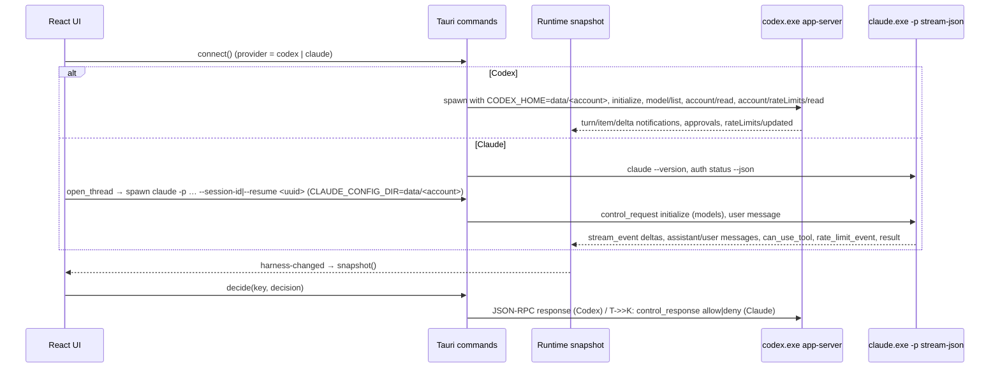

# Architecture

The browser UI never receives a raw process handle, shell bridge, filesystem bridge, or API key. Tauri
commands are narrow domain operations and the Rust process owns the child transports. Two engines share
one snapshot model, so the UI renders Codex and Claude the same way.

* `state.rs` — `Runtime` is the authoritative in-memory snapshot (items, threads, approvals, models,
  account, usage, notices). Generations stop events from a replaced process from changing state.
* `rpc_transport.rs` — Codex JSON-RPC over stdio (8 MiB frames, request timeouts, Job Object).
* `claude.rs` — Claude process per open conversation; maps stream-json onto the shared item model
  (`agentMessage`, `commandExecution`, `fileChange`, `toolCall`, `reasoning`), lists and loads chats
  from `projects/<sanitized cwd>/<uuid>.jsonl`, and runs `claude auth login|logout|status`. When the
  model, effort, permission mode, account or network settings change, the process restarts with
  `--resume`.
* `netenv.rs` — child environment (proxy, CA, temp folder, removed variables) and school-computer
  startup checks (inside a ZIP, OneDrive, low disk, network share, long path, PAC proxy).
* `portable_paths.rs` — portable folder layout, config with automatic repair of old or invalid values,
  per-account homes, atomic saves with retries, single-instance lock.
* `tools.rs` — portable programming tools: pinned downloads (curl.exe + SHA-256), install into
  `tools/`, status, the shared tools environment, AI notes, Run (`uv run` / `cargo run` /
  `npm run dev`) and Terminal consoles.
* `scaffold.rs` — New project templates (Python tkinter/console via `uv init` + `uv sync`, Rust
  console/egui via `cargo init` + first build, Node.js + Convex via npm, empty), plus AGENTS.md/CLAUDE.md.
* `commands.rs` — Tauri commands; each routes to the active provider. Long tasks (tool installs,
  project setup, classroom copy) run as background jobs shown in the snapshot.

Usage meters: Codex sends `account/rateLimits/read` / `account/rateLimits/updated` (primary ≈ 5-hour,
secondary ≈ weekly). Claude sends `rate_limit_event` with `five_hour` / `seven_day` utilization while it
answers. Values are stored per account in `config.json` with a timestamp, so inactive accounts show
their last known usage.

Shutdown cancels pending requests, stops both child types (Job Objects kill descendants), and cancels a
running sign-in. An unexpected Codex exit sets a failed lifecycle; an unexpected Claude exit ends the turn
and the next message restarts the process. The client never replays an in-flight command.
